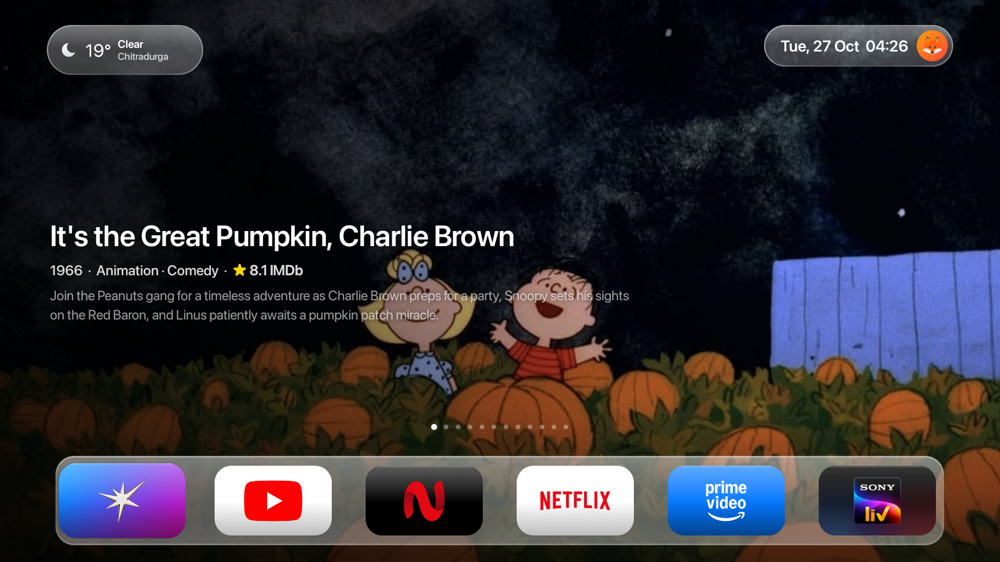
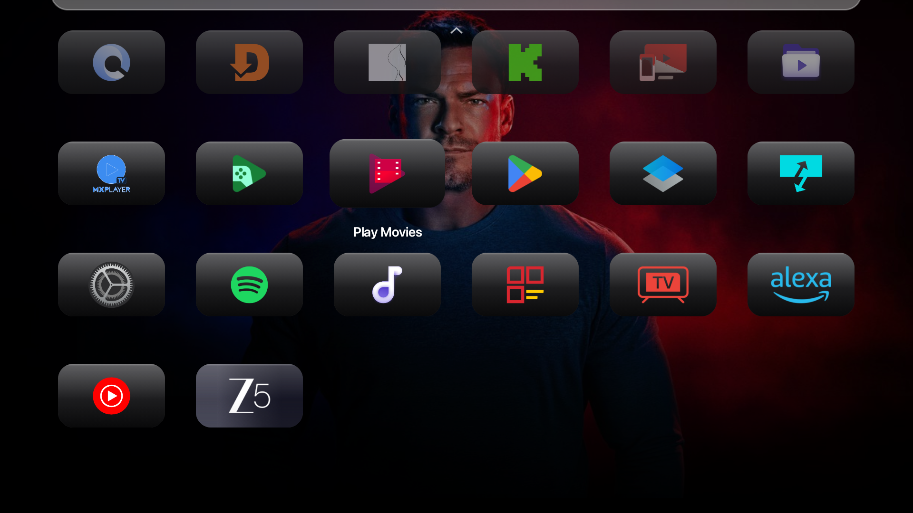
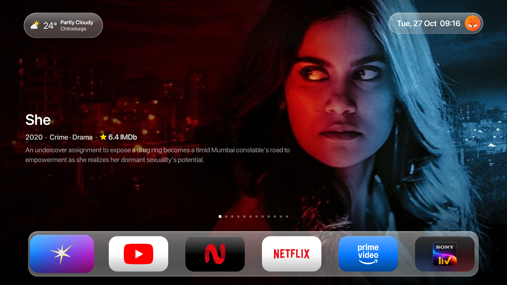
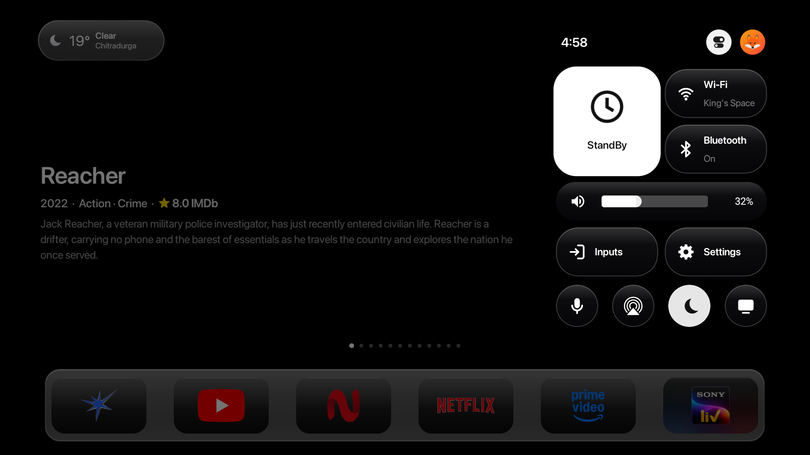
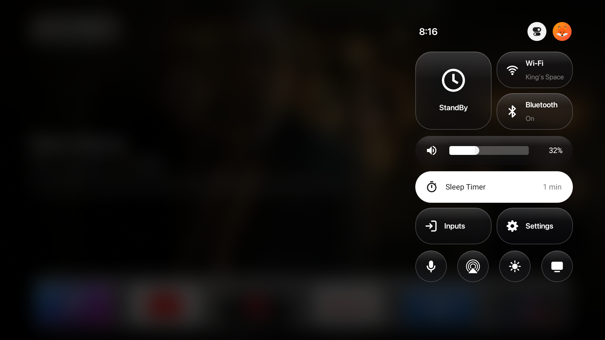

# Zaru TV

Apple TV, on a Google TV.


A home screen for Android TV and Google TV: a cinematic hero, a glass dock, a Control Center on the gear key, an iPhone-style volume HUD, and an aerial screensaver. Plain Java, built to stay smooth on a 1 GB TV. `minSdk` 26.

If this is the home you wanted on your TV, a star helps other people find it.

This is the **shipping product**: one APK, package `com.zaru.tv`, version **1.2**. No accounts, no API keys, no cloud agent. The optional experiment that also has Ambient, Jarvis and Tonight lives in a [separate repo](https://github.com/abuzar310/zaru-os) with its own package, so this app on your TV is never overwritten by it.

## See it

| | |
|:---:|:---:|
| <br>**Cinematic hero** | <br>**Focus lift** |
| <br>**Ambient glow** | <br>**Control Center** |
| <br>**Sleep timer** | <br>**Aerial screensaver** |

## What you get

Two looks, one package. The default Home is the **vibe** screen. The classic grid is still there as all-apps, and you can make it Home if you prefer.

### Vibe home (`VibeHomeActivity`)

The default HOME. A full-bleed black-and-white still from the shows your own apps already publish (`preview_program` / `watch_next_program`, `READ_TV_LISTINGS`). A thin clock with the weather, three outline icons, one line of text for the focused app, and a dock of white logos with a glow in that app’s colour. Outfit throughout. Down opens the classic grid; Back closes it. Settings opens the Control Center.

### Classic home (`MainActivity`)

A tvOS-style dock and app grid.

- **Living hero.** Focused dock art fills the top of the screen, with a slow Ken Burns drift and a cinematic scrim so the name stays readable.
- **Show art.** When a streaming app has published cards, the shelf uses a real poster instead of a softened banner (`ShowArt`).
- **Glass dock.** First row is the dock (`dock_apps` in `config.xml`). Focused tiles spring up (scale 1.18, lift, soft shadow). Compositor-only — no 3D tilt that janks a 1 GB GPU.
- **Ambient glow.** The rim of the screen takes the hero’s colour, then a focused app’s brand colour.
- **Glass widgets.** Large clock, date, and an Open-Meteo weather card (city / lat / lon in `config.xml`). No location permission, no weather API key.
- **Inputs.** The Inputs pill talks to the TV’s own switcher (`TvInputManager`), plus a configurable Live TV package.

### Control Center (gear key)

`HomeKeyService` catches the remote’s Settings / gear key and opens `QuickSettingsActivity` over whatever is on screen. The app behind keeps running; Back returns to it.

- **Now Playing.** Artwork, title and a progress line for whatever any app is playing. OK plays or pauses; Left / Right skip 10 seconds. Hidden while nothing plays. Needs the notification listener (below).
- **Sleep timer.** Off / 15 / 30 / 60 / 90. A minute before the end a notice counts down over any app; any button keeps the TV on. Otherwise it pauses media and puts the TV to sleep.
- **Turn off.** Same lock-screen action as the timer.
- **Wi-Fi, inputs, sound, display, TV settings, apps, launcher settings.**

### Volume HUD

One tall iPhone-style capsule over Android TV’s own bar. Android TV hands volume keys to the system before any accessibility service sees them, so the HUD follows `VOLUME_CHANGED_ACTION`. A Bluetooth remote sends no repeats while a key filter runs; hold-to-repeat is done through the system key log (`READ_LOGS`), one step every ~90 ms after a 0.4 s hold.

### Screensaver

Three `DreamService`s ship:

| Service | What it is |
|---|---|
| **`AerialDreamService`** | Default. Your photos StandBy-style (clock, date, weather, month calendar) plus a muted Pexels aerial between them. |
| **`AerialDream`** | Apple aerial `.mov` / `.mp4` files you download into `files/aerials/`. |
| **`ClockDream`** | A light clock on black, for weak GPUs. |

Sideloaded apps on many TVs cannot change the active screensaver themselves. Set it over adb (below) or try **Settings → System → Screen saver**. Your own photos: [docs/SCREENSAVER.md](docs/SCREENSAVER.md).

### Everything else

- **Browse deck.** From the vibe home, a left-skip / right-play card deck over the same TV listings.
- **App library.** Optional full list of launchable apps beyond the grid (`app_library` in config).
- **Module cards.** Third-party dock tiles (`docs` / card spec), signer-pinned.
- **Festivals / F1.** Theme-driven diya / marigold / greeting, and a race-weekend countdown from a theme calendar.
- **`tvx-mod`.** Optional motion layer you can inject into *your* local copy of another launcher. That other APK is not in this repo. See [`tvx-mod/README.md`](tvx-mod/README.md).

How each piece is built: [docs/FEATURES.md](docs/FEATURES.md). What landed on the real TV: [CHANGELOG.md](CHANGELOG.md). Where it is heading: [ROADMAP.md](ROADMAP.md).

## Install

### From the website (easiest)

Download the app and the TV steps: **[zaru-tv.vercel.app](https://zaru-tv.vercel.app)**

The file there is **Zaru TV 1.2**, package `com.zaru.tv`. On the TV:

1. Install **Downloader** from the Play Store.
2. Enter `https://zaru-tv.vercel.app/zaru-tv-1.2.apk`.
3. Allow the install.
4. Set **Zaru TV** as the Home app (the TV’s own “Home” / “Launcher” picker).

### Build it yourself

Needs **JDK 17** and Android SDK **platform 34**.

```bash
cd launcher
./gradlew assembleDebug
adb install -r app/build/outputs/apk/debug/app-debug.apk
```

Release builds (`assembleRelease`) minify with R8. A release keystore is optional and stays outside the repo; without it the release APK is debug-signed.

`launcher/build-and-install.sh` builds release, can disable the stock launcher, sets Home, and grants the permissions below.

### One-time adb grants

The gear, volume hold, Now Playing and screensaver need these once. An install can reset them.

```bash
adb shell settings put secure enabled_accessibility_services com.zaru.tv/.HomeKeyService
adb shell settings put secure accessibility_enabled 1
adb shell pm grant com.zaru.tv android.permission.READ_LOGS
adb shell cmd notification allow_listener com.zaru.tv/com.zaru.tv.MediaListener
adb shell settings put secure screensaver_components com.zaru.tv/.AerialDreamService
adb shell pm grant com.zaru.tv android.permission.READ_TV_LISTINGS
```

| Grant | Why |
|---|---|
| `HomeKeyService` | Gear → Control Center; Xiaomi Home; volume HUD; sleep timer |
| `READ_LOGS` | Hold-to-repeat on a Bluetooth volume key |
| `MediaListener` | Now Playing from other apps (the listener itself reads nothing) |
| `AerialDreamService` | Makes the aerial the active screensaver |
| `READ_TV_LISTINGS` | Posters on the vibe home and cinematic shelf |

More, including your own screensaver photos: [docs/BUILD.md](docs/BUILD.md) and [docs/SCREENSAVER.md](docs/SCREENSAVER.md).

## Configure

Edit `launcher/app/src/main/res/values/config.xml` and rebuild, or push a theme (`config.json` in the app’s external files) so you do not have to rebuild.

| Key | What it does |
|---|---|
| `dock_apps` | Apps on the dock, in order. Missing packages are skipped. |
| `hidden_apps` | Never shown as tiles. |
| `columns` | Tiles per row (6 in this build). |
| `cinematic_home` | Softened art shelf on the classic home (on). |
| `glass_widgets` | Large clock + weather (on). |
| `weather_city` / `weather_lat` / `weather_lon` | Open-Meteo place. Change all three together. Default is Chitradurga. |
| `settings_key_panel` | Gear opens the Control Center (on). |
| `reduced_motion` | Stiffer springs, shorter fades, for weak GPUs. |
| `vibe_taglines` | One-liners on the vibe home (`package\|line`). |

Switch looks without a rebuild:

```bash
# Classic grid as Home
adb shell cmd package set-home-activity com.zaru.tv/.MainActivity
# Vibe home (default)
adb shell cmd package set-home-activity com.zaru.tv/.VibeHomeActivity
```

## Requirements

| | |
|---|---|
| **TV** | Android TV or Google TV, Android 8.0+ (`minSdk` 26). Aimed at 1 GB boxes. |
| **Language** | Java 17. No Kotlin in the app. |
| **SDK** | `compileSdk` / `targetSdk` 34. |
| **Deps** | AndroidX RecyclerView + DynamicAnimation. JUnit 4 for JVM tests only. |
| **Network at runtime** | Open-Meteo for weather. Optional Apple aerial CDN if you use the aerial store. No accounts. |

Fire TV is not a first-class target here. That work lives on [Zaru OS](https://github.com/abuzar310/zaru-os).

## Layout

| Folder | What it is |
|---|---|
| [`launcher/`](launcher/) | The Zaru TV home you install (`com.zaru.tv`). |
| [`tvx-mod/`](tvx-mod/) | Optional motion layer (`com.zaru.tvx`) for a local copy of another launcher. That other app is not in this repo. |
| [`docs/`](docs/) | Features, build, screensaver, architecture. |

## Related: Zaru OS

[abuzar310/zaru-os](https://github.com/abuzar310/zaru-os) is a **separate** product: this home plus Halo TV’s Ambient screen, Jarvis, and Tonight. Different packages (`com.zaru.os`, `com.zaru.tonight`), so you can install it next to Zaru TV 1.2 and compare. It needs a TMDB token for Tonight. This repo stays the simple, key-free home.

## License

MIT. Copyright 2026 Abuzar (Zaru TV). Portions copyright the [cleanyourtv](https://github.com/Gathin23/cleanyourtv) authors. See [LICENSE](LICENSE).

The aerial clip (`launcher/app/src/main/res/raw/aerial_loop.mp4`) is from [Pexels](https://www.pexels.com/). App names, logos and artwork belong to their owners.
