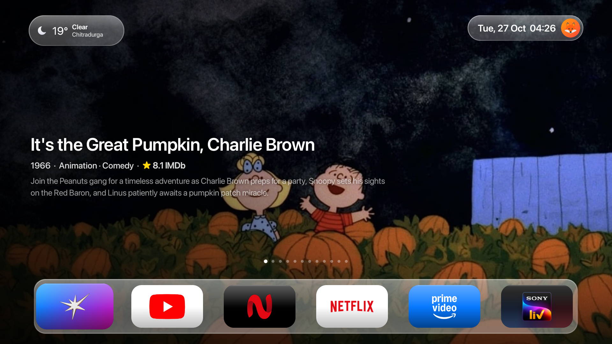
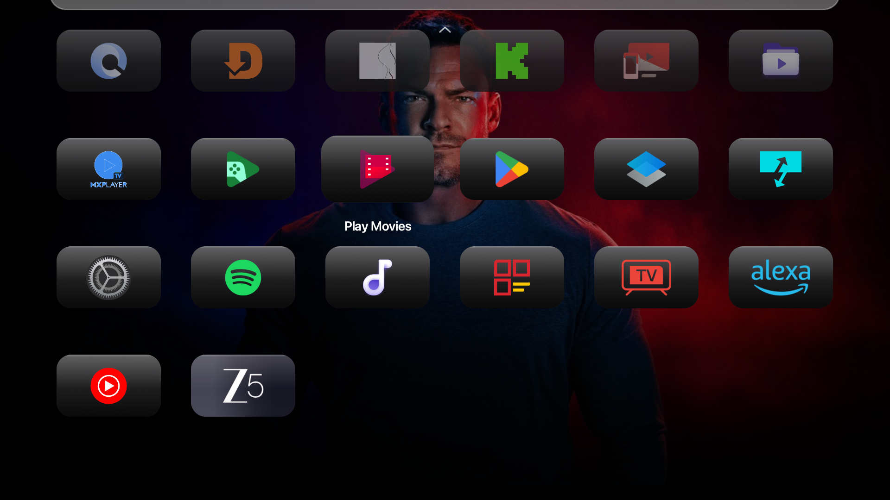
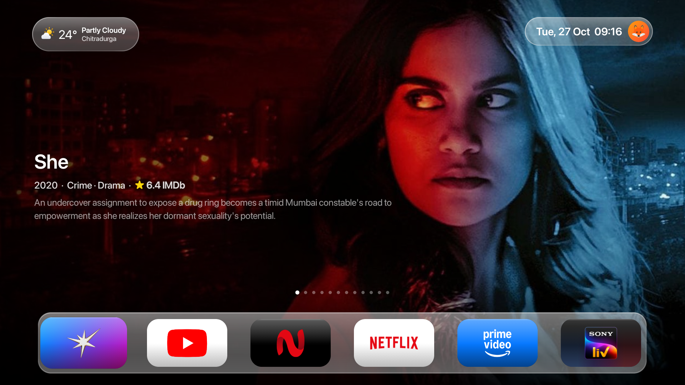
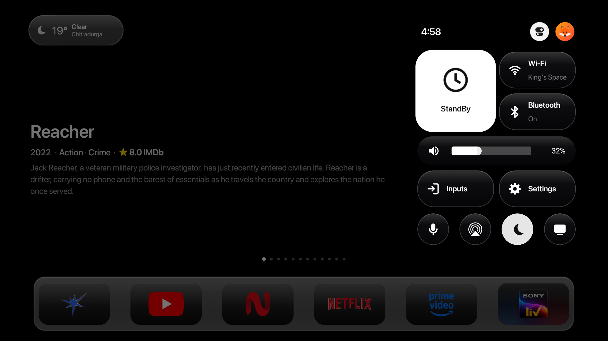
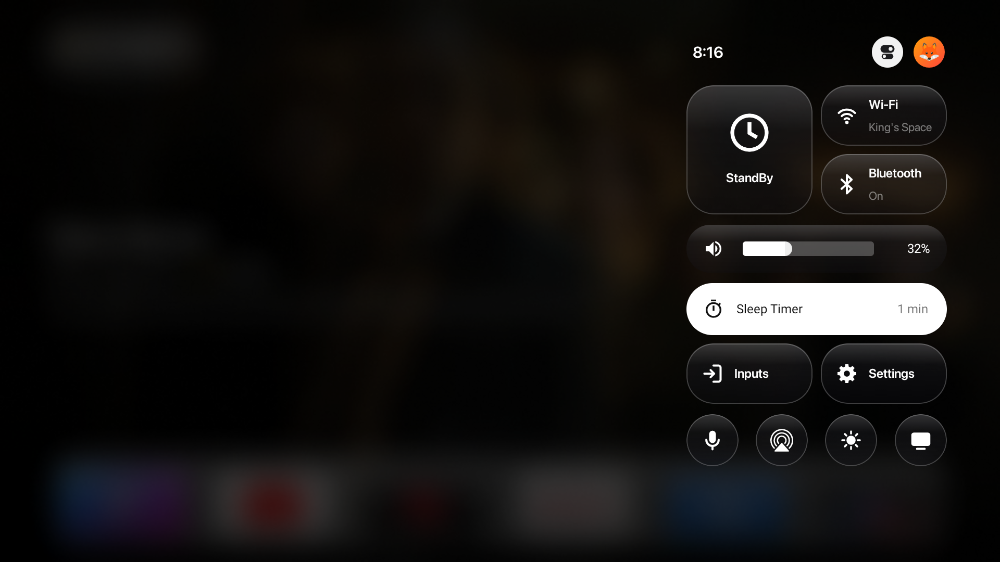
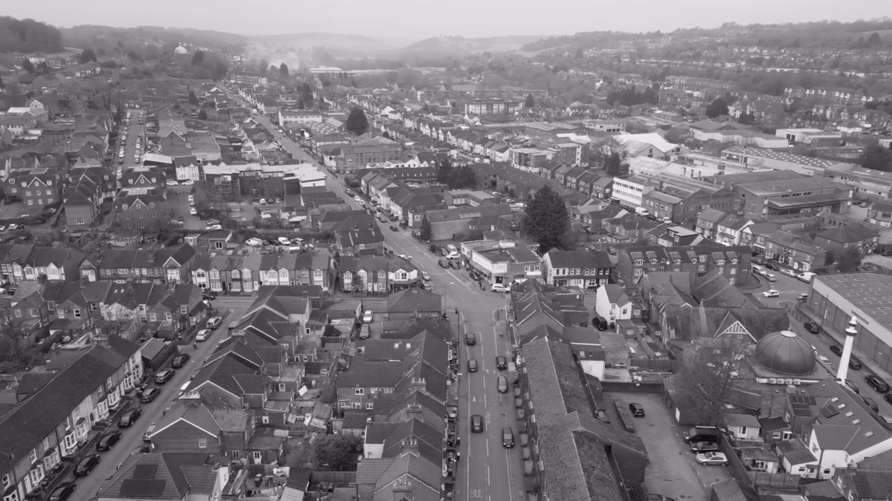

# Zaru TV

Apple TV, on a Google TV.


A home screen for Android TV and Google TV: a cinematic hero, a glass dock, a Control Center on the gear key, an iPhone-style volume HUD, and an aerial screensaver. Plain Java, built to stay smooth on a 1 GB TV. `minSdk` 26.

If this is the home you wanted on your TV, a star helps other people find it.

## See it

| | |
|:---:|:---:|
| <br>**Cinematic hero** | <br>**Focus lift** |
| <br>**Ambient glow** | <br>**Control Center** |
| <br>**Sleep timer** | <br>**Aerial screensaver** |

## Install

JDK 17 and Android SDK platform 34.

```bash
cd launcher
./gradlew assembleDebug
adb install -r app/build/outputs/apk/debug/app-debug.apk
```

The package is `com.zaru.tv`. On the TV, choose it as the Home app. The gear, volume hold, Now Playing and screensaver need these once:

```bash
adb shell settings put secure enabled_accessibility_services com.zaru.tv/.HomeKeyService
adb shell settings put secure accessibility_enabled 1
adb shell pm grant com.zaru.tv android.permission.READ_LOGS
adb shell cmd notification allow_listener com.zaru.tv/com.zaru.tv.MediaListener
adb shell settings put secure screensaver_components com.zaru.tv/.AerialDreamService
```

Details, including your own screensaver photos: [docs/BUILD.md](docs/BUILD.md) and [docs/SCREENSAVER.md](docs/SCREENSAVER.md).

The weather card uses the place in `launcher/app/src/main/res/values/config.xml` (`weather_city`, `weather_lat`, `weather_lon`). Change those three to your city.

## What you get

- **Living hero.** The featured backdrop slowly zooms and pans.
- **Glass dock.** App tiles with a spring when they take focus. Compositor-only, so it stays smooth on a 1 GB GPU.
- **Ambient glow.** The rim of the screen takes the hero's colour, then a focused app's brand colour.
- **Control Center.** The gear key opens it over whatever is on screen: Now Playing (OK plays or pauses, Left and Right skip 10 seconds), a sleep timer (Off / 15 / 30 / 60 / 90), Wi-Fi, inputs and settings.
- **Volume HUD.** One tall capsule over Android TV's own bar. Hold the volume key and it keeps stepping.
- **Screensaver.** Your photos, StandBy-style, with a clock, the date, the weather and a month calendar, and a muted aerial clip between them.

How each piece is built: [docs/FEATURES.md](docs/FEATURES.md). Where it's going: [ROADMAP.md](ROADMAP.md).

## Layout

| Folder | What it is |
|---|---|
| [`launcher/`](launcher/) | The Zaru TV home you install (`com.zaru.tv`). |
| [`tvx-mod/`](tvx-mod/) | An optional motion layer (`com.zaru.tvx`) you can apply to your own local copy of another launcher. That other app is not in this repo, and it is not redistributed from here. See [`tvx-mod/README.md`](tvx-mod/README.md). |

## License

MIT. Copyright 2026 Abuzar (Zaru TV). See [LICENSE](LICENSE).

The aerial clip (`launcher/app/src/main/res/raw/aerial_loop.mp4`) is from [Pexels](https://www.pexels.com/).
